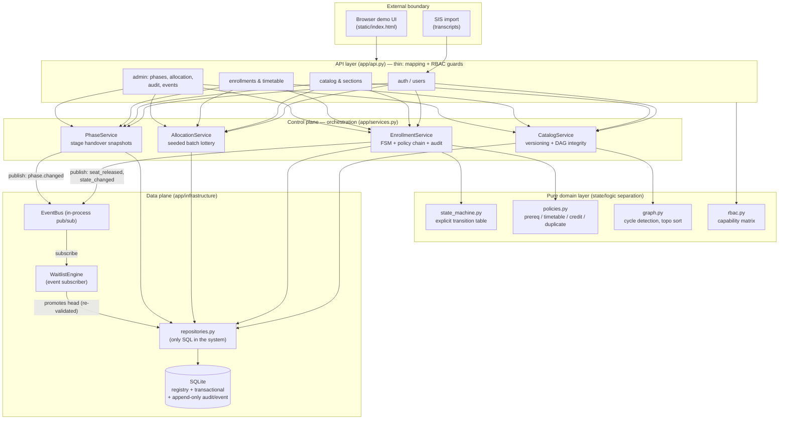
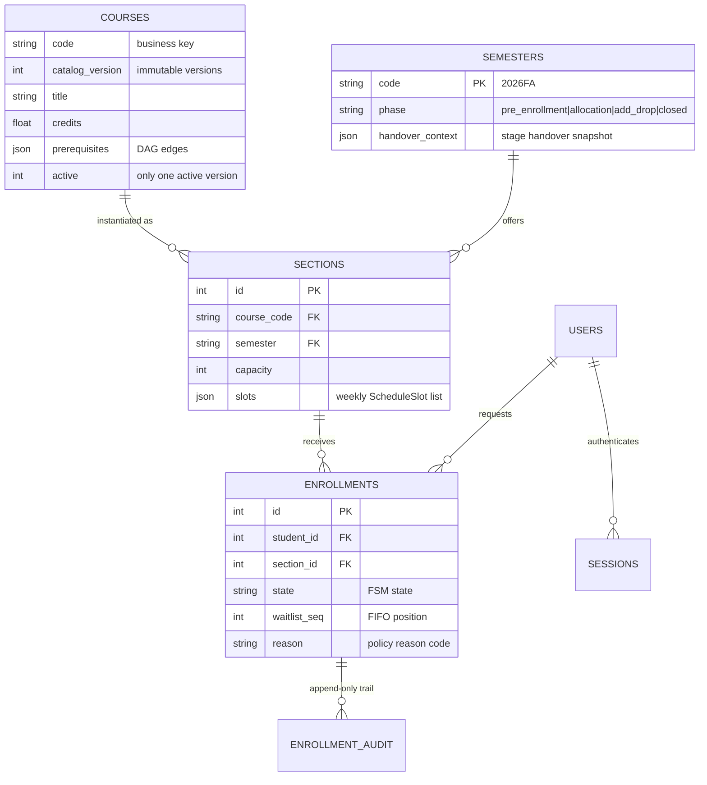
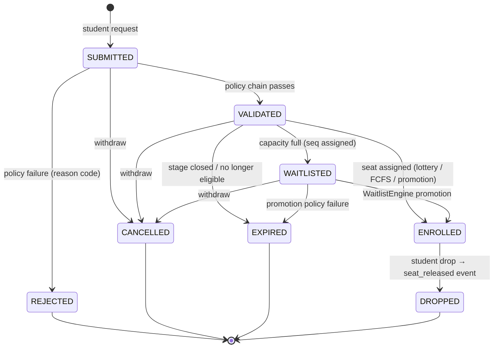

# CourseFlow: A Course Registration & Timetable Orchestration System

**Course:** MAiNS (Models and Algorithms in Networks and Systems)
**Project Track:** Option 4 — Self-Defined Project
**Team Members:** [Name 1, Name 2, Name 3]
**Repository Link:** [URL — push the local Git repo to GitHub/GitLab and paste the link here]

---

## Executive Summary

CourseFlow is a university course registration and timetable orchestration
system that manages the full lifecycle of enrollment requests across the
three stages of a semester's registration calendar. Although "course
registration" is a familiar domain, the system exhibits the three canonical
complexity dimensions examined in MAiNS. *Structurally*, it is organized as
a strict layered architecture — REST API, orchestration services, pure
domain policies, and persistence — with an in-process event bus decoupling
reactive components (the waitlist engine) from request handling.
*Behaviorally*, every enrollment is governed by an explicit finite state
machine with an append-only audit trail, and the semester itself is a
multi-stage pipeline (pre-enrollment → allocation → add/drop → closed) in
which each stage transition performs a snapshot-based stage handover;
role-based access control is enforced through a capability matrix plus
row-level rules. *Semantically*, the catalog is a formal, versioned
registry whose prerequisite graph is protected by cycle detection, and
every enrollment request is validated against a composable constraint
chain (prerequisites, timetable interval conflicts, credit ceilings,
duplicate/retake rules) that yields machine-readable reason codes. A naive
monolithic implementation — a database and a form — fails here because
constraint logic, stage behavior, and authorization concerns entangle into
untestable spaghetti. We demonstrate the architecture with 37 automated
tests and a scripted end-to-end execution trace, and we analyze scaling
limits and architectural trade-offs.

---

## 1. System Domain & Problem Statement

### 1.1 The macroscopic problem

Every academic semester, a university must assign a scarce, shared pool of
seats (sections) to a large population of students whose requests arrive
concurrently and conflict with each other, under rules that change over
time:

- **Registry rules (semantic).** Courses carry credits, departments, and
  prerequisite relations forming a curriculum DAG; the catalog evolves and
  must therefore be versioned without corrupting in-flight semesters.
- **Workload rules (semantic).** A student may not exceed a per-semester
  credit ceiling, may not take two sections whose weekly meetings overlap,
  may not enroll twice in the same course, and may not retake a passed
  course.
- **Calendar rules (behavioral).** Registration proceeds through phases:
  a capacity-blind *pre-enrollment* wish collection, a batch *allocation*
  (capacity assignment/lottery), a first-come-first-served *add/drop*
  phase with automatic waitlist promotion, and a terminal *closed* phase.
- **Authorization rules (behavioral).** Students act on their own
  enrollments; instructors observe rosters of their own sections; the
  registrar runs the orchestration machinery; the admin manages users.

### 1.2 Operational scale, inputs, and outputs

- **Inputs:** student enrollment requests (student, section); catalog and
  section definitions (registrar); phase-advance commands (registrar);
  transcripts (imported from the student information system).
- **Outputs:** enrollment decisions (ENROLLED / WAITLISTED / REJECTED with
  a reason code), conflict-free timetables, section rosters, audit trails,
  and an event log.
- **Scale:** a mid-size deployment serves tens of thousands of students,
  thousands of sections, and bursty request peaks (registration opens) —
  the design target that drives the state/event separation described below.

### 1.3 Why a naive approach fails

A monolithic implementation puts a single `enroll()` function behind a form:
it must simultaneously check capacity, prerequisites, timetable overlap,
credit limits, the current phase, the caller's role, and then update
waitlists of *other* students when seats free up. Every new rule
("priority for seniors", "swap requests") edits the same function, so
constraint logic becomes untestable and un-auditable; phase behavior is
spread across `if` statements; and when the catalog changes mid-semester,
in-flight enrollments silently change meaning. Complexity explodes in the
*interaction* of concerns, not in any single rule — exactly the failure
mode MAiNS targets. CourseFlow's answer is to give each concern a home:
policies are pure functions, lifecycle is a formal FSM, stages are an
explicit machine with handover snapshots, and cross-cutting reactions ride
an event bus.

---

## 2. Macroscopic Architectural Specification

### 2.1 High-Level Component Architecture

CourseFlow separates a **control plane** (orchestration services, phase
machine, allocation) from a **data plane** (repositories, audit/event
logs), and isolates **pure domain logic** (FSM, policies, graph
algorithms) between them. The HTTP layer is deliberately thin: it maps
REST to service calls and enforces RBAC, but contains no domain logic.



**Separation of concerns.**

- *Control vs. data plane:* services never issue SQL; `repositories.py` is
  the single module that touches the database, giving tests one seam and
  making the persistence engine replaceable.
- *Orchestration vs. execution:* `EnrollmentService` orchestrates a
  use-case (validate → transition → audit → publish) while *execution*
  details live in pure modules (`policies.py`, `state_machine.py`,
  `graph.py`) that are unit-testable without HTTP or database.
- *Synchronous vs. reactive:* seat release is a published fact; the
  `WaitlistEngine` subscribes and promotes asynchronously-in-principle,
  removing waitlist polling loops from the enrollment path.

### 2.2 Data Models & Schema Design

The data registry separates **registry tables** (users, courses, sections,
semesters), **transactional state** (enrollments), and **immutable
evidence** (append-only `enrollment_audit` and `event_log`).



**Formal schemas as the semantic contract.** Everything crossing the API
boundary is a Pydantic model (`app/models.py`); the JSON Schemas are
exported as build artifacts in `docs/schemas/`
(`course.schema.json`, `section.schema.json`, `schedule_slot.schema.json`),
acting as the system's formal data registry. For example, a course entry
is exactly:

```json
{
  "code": "^[A-Z]{2,4}[0-9]{2,4}$",
  "title": "string (2..128)",
  "credits": "number 0.5..12",
  "department": "string",
  "prerequisites": ["CS101"]
}
```

**Ontology of the domain.** The semantic layer has three entity classes —
*Actor* (student/instructor/registrar/admin), *Offering* (course →
section), and *Request* (enrollment with lifecycle) — and two relation
systems: the **prerequisite DAG** over courses (an edge means "must pass
before") and the **timetable interval structure** over sections (weekly
`(day, start, end)` tuples). Both are first-class: the DAG is checked for
acyclicity on every catalog mutation and can be queried in topological
study order (`GET /courses/curriculum-order`); the interval structure is
consumed by the conflict policy.

### 2.3 Behavioral State Machine & Control Flow

#### 2.3.1 Enrollment lifecycle FSM

Every enrollment record moves through an explicitly declared transition
table (`app/state_machine.py`). Illegal transitions raise
`InvalidTransitionError`; every *legal* transition is written to the
append-only audit trail before the event bus is notified.



The FSM is pure (no I/O), which yields strong guarantees: state is never
edited in place — it only *moves along declared edges*, and each move is
audited. This is the "state immutability" discipline of the design.

#### 2.3.2 Multi-stage semester pipeline with stage handover

The semester is itself a four-state machine whose states change what
enrollment *means*:

```mermaid
stateDiagram-v2
    [*] --> PRE_ENROLLMENT
    PRE_ENROLLMENT --> ALLOCATION : registrar advance
    ALLOCATION --> ADD_DROP : registrar advance
    ADD_DROP --> CLOSED : registrar advance
    PRE_ENROLLMENT : capacity-blind wishes (SUBMITTED→VALIDATED only)
    ALLOCATION : batch seeded lottery; direct enrollment locked
    ADD_DROP : first-come-first-served + waitlist promotions
    CLOSED : frozen, read-only
```



On each advance, `PhaseService` builds a **handover snapshot** (per-section
counts of ENROLLED / VALIDATED-pending / WAITLISTED) and stores it in the
`semesters.handover_context` column before publishing `phase.changed`.
The incoming stage therefore starts from an explicit, queryable context
rather than implicit in-memory state — zero loss of state across stage
transitions.

```mermaid
sequenceDiagram
    participant Reg as Registrar
    participant API as API layer
    participant ENR as EnrollmentService
    participant PH as PhaseService
    participant AL as AllocationService
    participant DB as Repository/Audit
    participant BUS as EventBus
    participant WL as WaitlistEngine

    Note over ENR: Phase = PRE_ENROLLMENT
    API->>ENR: enroll(student, section)
    ENR->>ENR: run policy chain (duplicate, prereq DAG, timetable, credits)
    ENR->>DB: SUBMITTED→VALIDATED + audit + event
    Reg->>API: advance phase
    API->>PH: advance()
    PH->>DB: snapshot {validated_pending, enrolled, waitlisted} → handover_context
    PH->>BUS: publish phase.changed
    Note over AL: Phase = ALLOCATION (direct enrollment PHASE_LOCKED)
    Reg->>API: run allocation (seed=42)
    API->>AL: run_allocation()
    AL->>DB: shuffle VALIDATED (seeded RNG); capacity → ENROLLED; rest → WAITLISTED(seq)
    Note over ENR,WL: Phase = ADD_DROP (FCFS)
    API->>ENR: enroll(student, section)
    ENR->>DB: VALIDATED→ENROLLED or →WAITLISTED(seq)
    API->>ENR: drop(enrolled)
    ENR->>DB: ENROLLED→DROPPED + audit
    ENR->>BUS: publish section.seat_released
    BUS->>WL: _on_seat_released(section)
    WL->>DB: FIFO head; re-run policy chain
    alt head still eligible
        WL->>DB: WAITLISTED→ENROLLED + audit
        WL->>BUS: publish waitlist.promoted
    else head ineligible (e.g. CREDIT_LIMIT)
        WL->>DB: →EXPIRED (reason recorded); scan next
    end
```

#### 2.3.3 RBAC

Authorization is capability-based (`app/rbac.py`): a matrix maps each role
to capabilities (`enroll:create`, `phase:advance`, `roster:read_any`, …);
routers guard endpoints with `require(capability)`, and row-level rules
sit on top (an instructor may open a roster only when the section's
`instructor_name` equals their own identity). The matrix is data, so
auditing "who can do what" is reading one table, and evolving roles does
not touch endpoint code.

---

## 3. Complexity Management Evaluation

| Complexity Dimension | Identified Bottleneck / Anti-Pattern | Applied Architectural Abstraction | Quantitative / Qualitative Outcome |
| :--- | :--- | :--- | :--- |
| **Structural** | Monolithic endpoint where HTTP, SQL, constraint rules, and state updates are interleaved; any rule change edits the same function | Strict 4-layer architecture (API → services → pure domain → repository); single SQL module; in-process event bus decoupling reactive components | Domain policies are pure functions unit-tested without HTTP/DB; 37 tests pass in ~17 s; replacing SQLite requires touching exactly one module |
| **Behavioral** | Context loss across registration stages; scattered `if phase == …` checks; waitlist polling; undocumented state edits | Formal FSM (declared transition table + audit per transition); 4-stage semester machine with **stage handover snapshots** persisted per advance; **event-driven** waitlist promotion; capability-matrix RBAC with row-level scoping | Illegal transitions are unrepresentable; zero state loss across stage handovers (snapshot queryable via API); promotion triggered by event with no polling loop; every decision traceable to actor+reason in the audit trail |
| **Semantic** | Unvalidated catalog edits corrupting prerequisite chains mid-semester; silent data drift; ad-hoc string error handling | Immutable **catalog versioning** (new version per edit, one active); DAG integrity via cycle detection on every mutation + topological study-order endpoint; formal JSON Schemas exported as registry artifacts; composable policy chain with machine-readable reason codes (`PREREQ_MISSING`, `TIMETABLE_CONFLICT`, `CREDIT_LIMIT`, `DUPLICATE_ENROLLMENT`, `ALREADY_PASSED`) | 100% of API payloads schema-validated; cycle edges rejected at write time (demonstrated in trace §2); every rejection carries a precise, testable reason code |

---

## 4. Implementation & Execution

### 4.1 Key engineering choices

- **Language & frameworks:** Python 3.11; FastAPI (typed REST, OpenAPI for
  free); Pydantic v2 as the schema/registry layer; SQLite for persistence;
  pytest + FastAPI `TestClient` for integration tests. Total runtime
  dependencies: five.
- **Design patterns:** *composition root* (`app/main.py` wires everything);
  *repository* (single SQL seam); *domain policy objects* (pure functions
  returning `PolicyResult(code, message)`); *publish–subscribe* event bus;
  *state machine as data* (a transition table, not nested ifs); *append-only
  audit & event logs* (evidence by construction).
- **Enforced invariants:**
  - *State immutability:* enrollment state changes only via
    `state_machine.transition()`; each transition appends to
    `enrollment_audit` (actor, from, to, reason, timestamp).
  - *Registry safety:* catalog rows are never edited — a new
    `catalog_version` is inserted and the old one deactivated, so
    in-flight semesters keep their meaning.
  - *RBAC:* capability check in every guarded route; password hashing with
    PBKDF2-HMAC-SHA256; bearer session tokens stored server-side.
- **Determinism where it matters:** batch allocation uses a seeded RNG
  (`seed=42` default), so a lottery outcome is reproducible for appeal
  audits — a small but decisive fairness feature.

### 4.2 Execution evidence

The scripted demo (`demo/seed_demo.py`) drives the REST API through the
full lifecycle; the complete trace is committed at `docs/demo_trace.md`.
Highlights:

```text
## 2. Semantic constraint enforcement (phase = pre_enrollment)
- `OK dave requests CS201.01` → HTTP 400
    - REJECTED: PREREQ_MISSING (dave has no CS101) — DAG policy
- `OK add cycle edge CS201 -> CS101` → HTTP 400
    - REJECTED: PREREQ_CYCLE — catalog graph integrity preserved
- `OK edit CS101 -> immutable version 2` → HTTP 200
    - CS101 now at catalog_version 2

## 3. Multi-stage orchestration
- `OK advance phase` → phase = allocation;
    handover snapshot: {'capacity': 2, 'enrolled': 0, 'validated_pending': 3, ...}
- `OK enroll while in ALLOCATION` → HTTP 400 PHASE_LOCKED
- `OK registrar runs seeded batch allocation` →
    {'CS201.01': {'capacity': 2, 'requests': 3, 'enrolled': 2, 'waitlisted': 1}}

## 4. add_drop: FCFS + event-driven waitlist promotion
- bob requests EE210.01 (cap 1) → ENROLLED
- alice requests EE210.01 → WAITLISTED (seq 1); erin → WAITLISTED (seq 2)
- charlie requests EE210.01 → HTTP 400 PREREQ_MISSING
- bob drops EE210.01 → section.seat_released → WaitlistEngine
- erin: WAITLISTED → ENROLLED (zero polling, event-driven)

## 5. Audit chain of erin's enrollment (#7):
    SUBMITTED → VALIDATED by erin (policies passed)
    VALIDATED → WAITLISTED by erin (section full, waitlisted)
    WAITLISTED → ENROLLED by system:waitlist (promoted from waitlist)
- event log: 19 events; types: enrollment.state_changed, phase.changed,
  section.seat_released, waitlist.promoted
```

The test suite mirrors the same guarantees at CI speed:

```text
$ python -m pytest tests -q
37 passed, 1 warning in ~17s
```

covering: FSM legality, all four policies, DAG cycle detection and
topological order, RBAC (including row-level instructor scoping), catalog
versioning, phase linearity and handover snapshots, seeded-lottery
determinism (two runs, same seed → same outcome), FIFO promotion, and
ineligible-head skipping with expiration reasons.

---

## 5. Verification, Scaling & Trade-off Analysis

### 5.1 Scaling limits

Let **S** = students, **C** = sections, **R** = requests per registration
peak, **K** = a student's active enrollments (~6), **V/E** = catalog graph
size.

| Operation | Cost today | Bottleneck as scale grows | Mitigation path |
| :--- | :--- | :--- | :--- |
| Enroll (policy chain) | O(K) overlap checks + O(1) credit/dup checks via SQL indexes | Timetable check loads K section rows each request | Cache student's active slots in memory; precompute slot bitmap |
| Batch allocation | O(R log R) shuffle + O(R) updates | Single transaction over all sections serializes the run | Per-section parallel jobs; idempotent allocation pass |
| Waitlist promotion | O(1) FIFO head + O(K) re-validation per seat | Burst of drops → burst of event handlers on one bus | Move bus to a real queue (Redis Streams / Kafka); per-section ordering keys |
| Catalog cycle check | O(V + E) DFS per mutation | Mutations are rare (registrar-time), negligible | Cache graph; incremental reachability |
| Concurrency | SQLite single-writer | Hundreds of concurrent enrollments serialize on the write lock | Postgres + row-level locking on section seat counters; or serialised seat tokens |

The architecture degrades **gracefully and locally**: because every
bottleneck above sits behind one module boundary, the scaling fixes
(cache layer, message broker, RDBMS swap) do not require touching the
domain logic.

### 5.2 Trade-off matrix

| Decision | Chosen | Alternative | Rationale & consequence |
| :--- | :--- | :--- | :--- |
| Consistency of seat assignment | Strong (synchronous in-request transaction; SQLite single-writer) | Eventual (async queue) | Registration decisions must be instantly consistent to avoid oversell; at campus scale the write lock is acceptable; documented path to Postgres |
| Event delivery | In-process bus, synchronous handlers, persisted log | External broker (Kafka/RabbitMQ) | Zero infrastructure, exactly-once within process, trivially debuggable; loses durability across restarts (mitigated: event_log replay) and multi-process fan-out |
| Waitlist re-validation on promotion | Re-run full policy chain | Trust admission-time validity | World may have changed while waiting (timetable, credits); cost is O(K) per promotion — correctness over speed |
| Catalog mutation | Immutable versions | In-place update | In-flight semesters must keep meaning; cost: version queries filter `active=1` |
| Audit trail | Append-only DB tables | Editable logs / no trail | Traceability is a hard requirement for disputes; storage grows O(transitions), acceptable |
| Allocation algorithm | Seeded random lottery | Strict priority (seniority) or first-come | Fairness + reproducibility for appeals; a priority scheme is a policy-chain extension, not a redesign |
| Auth | Server-side session tokens | JWT | Revocable, no crypto key management; fine for single-service deployment |

### 5.3 Failure-mode analysis

- **Duplicate seat assignment under concurrency:** prevented today by
  SQLite's single-writer model; on Postgres, the `UNIQUE(student, section)`
  constraint plus a conditional seat-count update inside one transaction
  preserves the invariant.
- **Event handler crash mid-promotion:** promotion is transactional
  (state + audit committed atomically); a crash before commit leaves the
  seat unreleased — the log-based design allows replaying
  `section.seat_released` events to reconcile.
- **Registrar advances phase with pending wishes:** impossible to lose
  them — the handover snapshot records `validated_pending` counts, and the
  allocation stage consumes exactly those records.

---

## 6. Conclusion & Future Work

**Lessons learned.** The project confirmed the MAiNS thesis that
complexity in networked systems is managed by *where you put concerns*,
not by the difficulty of any individual rule. Three practices carried the
most weight: (1) making lifecycle a *declared transition table* with
mandatory auditing, which turned "who changed what and why" from a
debugging question into a SELECT; (2) making stage transitions *explicit
handovers with persisted snapshots*, which eliminated an entire class of
"context lost between stages" bugs by construction; and (3) keeping
domain policies pure, which made the constraint system — the semantic
heart of the system — trivially testable and composable.

**Remaining bottlenecks & future refactoring.**

1. **Concurrency at scale:** replace SQLite + in-process bus with Postgres
   + a message broker; the repository and bus interfaces are already the
   seams for this swap.
2. **Multi-semester registry:** the runtime pins one active semester
   (`app/runtime.py`); generalizing requires a semester-scoped repository
   API — plumbing, not redesign.
3. **Richer allocation policies:** seniority priority, course caps per
   program, and swap requests slot into the policy chain as additional
   pure validators.
4. **Observability:** the event log is the seed of a real observability
   stack (metrics on wait times, rejection reasons, allocation skew).

---

## References & Appendix

**References**

1. FastAPI documentation — https://fastapi.tiangolo.com/
2. Pydantic v2 documentation (JSON Schema export) — https://docs.pydantic.dev/
3. Kahn, A. B. (1962). "Topological sorting of large networks." *Communications of the ACM*, 5(11).
4. Fowler, M. (2002). *Patterns of Enterprise Application Architecture* — Repository, Layering patterns.
5. Rich Internet guidance on C4 model for architecture diagrams — https://c4model.com/
6. SQLite documentation (concurrency, locking) — https://www.sqlite.org/lockingv3.html

**Appendix A — Repository layout**

```text
courseflow/
├── app/
│   ├── main.py            # composition root (wiring)
│   ├── api.py             # thin REST layer + RBAC guards
│   ├── services.py        # control plane: Catalog / Enrollment / Allocation / Phase
│   ├── waitlist.py        # event-driven WaitlistEngine
│   ├── state_machine.py   # FSM transition table (pure)
│   ├── policies.py        # constraint chain (pure)
│   ├── graph.py           # DAG: cycle detection + topological order (pure)
│   ├── events.py          # EventBus + event types
│   ├── rbac.py            # capability matrix
│   ├── models.py          # Pydantic registry schemas
│   ├── repositories.py    # the only SQL module
│   ├── database.py        # SQLite DDL + connections
│   ├── enums.py / runtime.py
├── static/index.html      # browser demo UI
├── demo/seed_demo.py      # scripted end-to-end demo (writes demo_trace.md)
├── tests/                 # 37 pytest cases
└── docs/                  # proposal, this report, JSON Schemas, demo trace
```

**Appendix B — How to run**

```bash
pip install -r requirements.txt
python run.py                  # serves API + demo UI at http://127.0.0.1:8000
python demo/seed_demo.py       # scripted end-to-end scenario + trace
python -m pytest tests -q     # 37 tests
```
