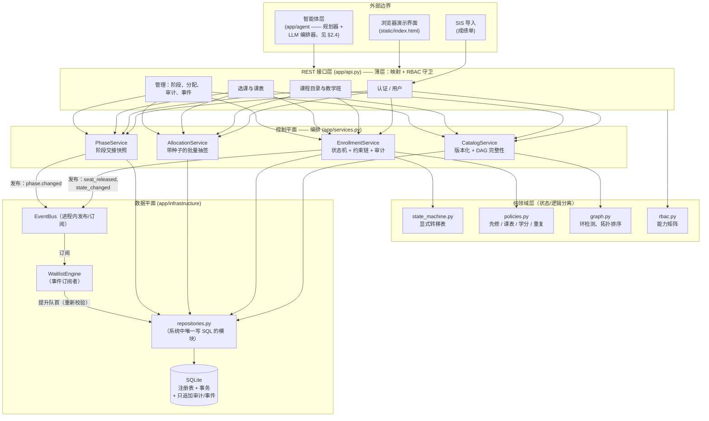
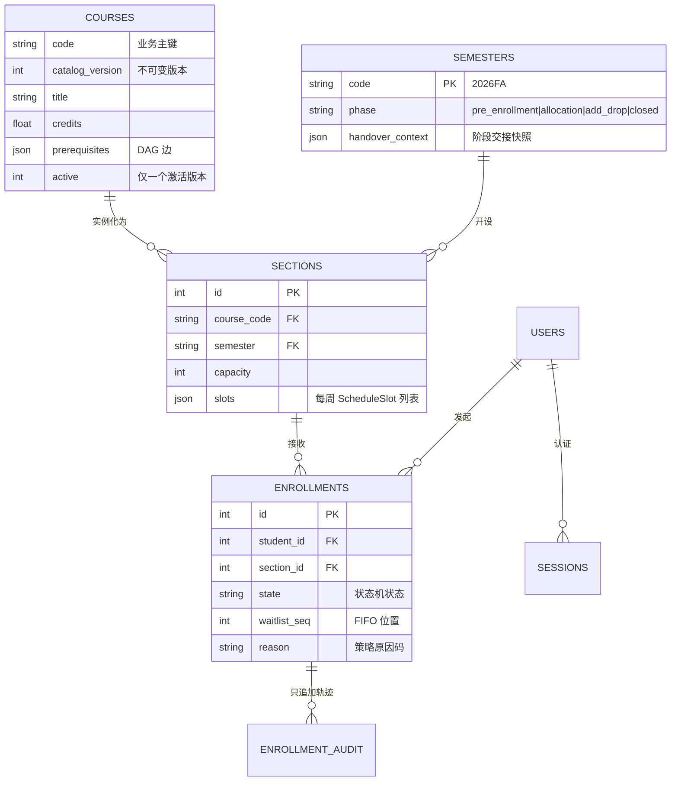
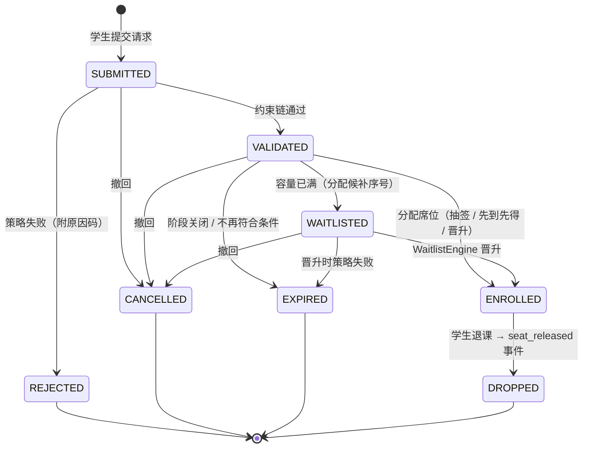
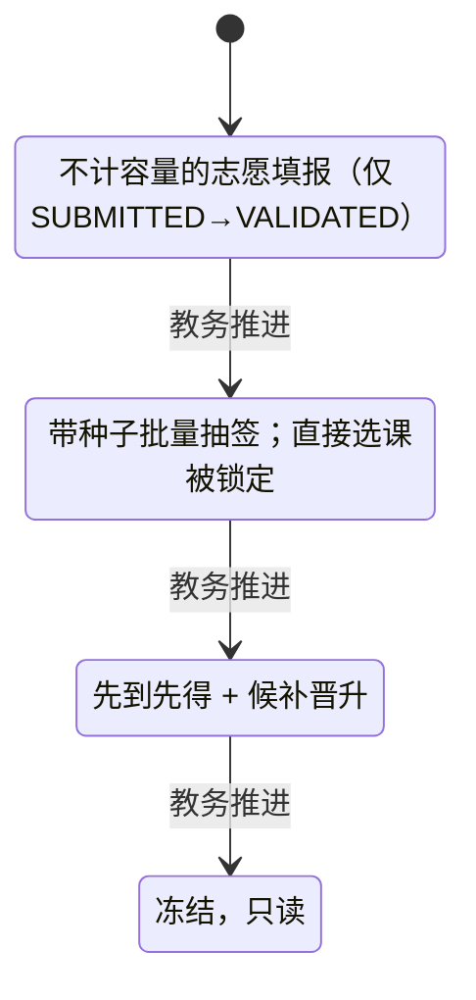
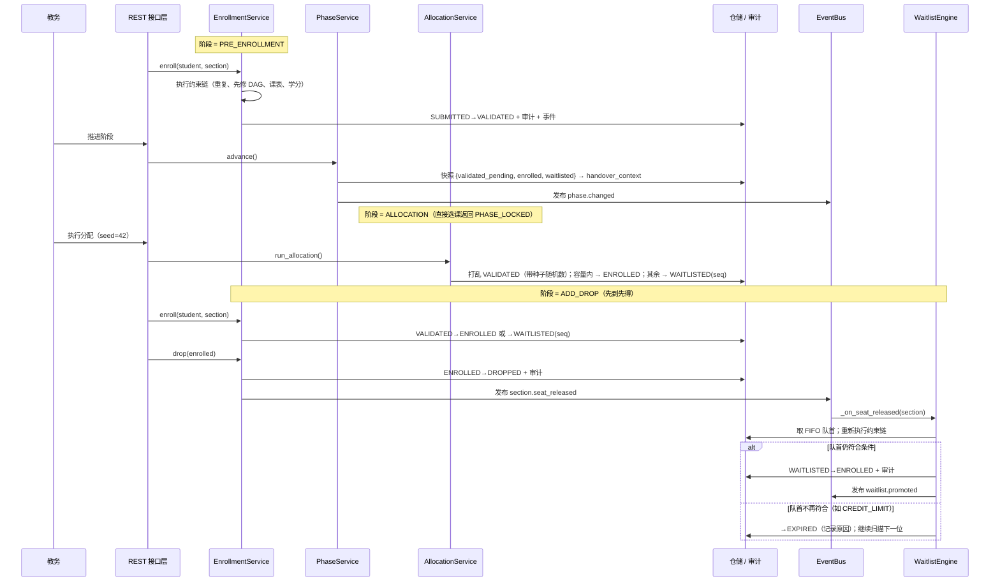
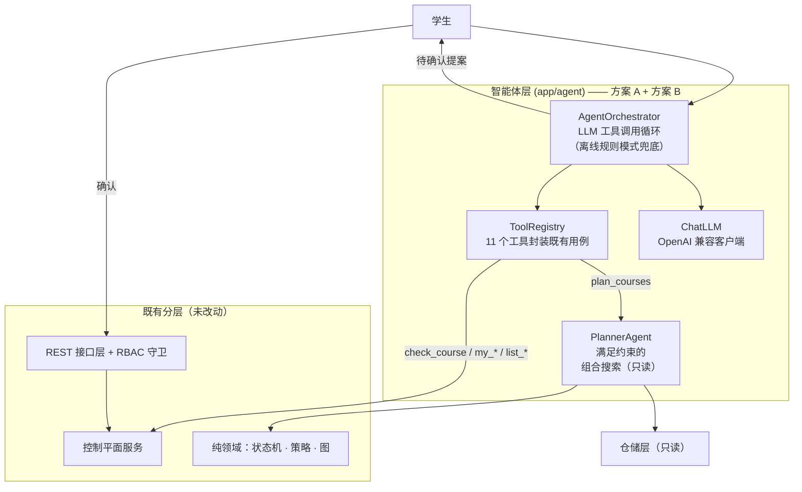

# CourseFlow：高校选课与排课编排系统 —— 系统架构与复杂度报告

**课程：** MAiNS（网络与系统中的模型与算法）
**项目类型：** 类型 4 —— 自定义项目
**小组成员：** 周益辰
**代码仓库：** https://github.com/yuedu16night/courseflow

---

## 摘要

CourseFlow 是一个高校选课与排课编排系统，管理选课请求在学期选课日历各阶段中的完整生命周期。尽管「选课」是一个熟悉的领域，本系统仍完整体现了 MAiNS 所考察的三个典型复杂度维度。*结构上*，系统组织为严格的分层架构 —— REST 接口层、编排服务层、纯领域策略层与持久化层 —— 并以一个进程内事件总线把响应式组件（候补引擎）与请求处理解耦。*行为上*，每一条选课记录都由显式有限状态机管理，并写入只追加的审计轨迹；学期本身是一条多阶段流水线（预选 → 抽签分配 → 补退选 → 截止），每次阶段推进都执行一次基于快照的阶段交接；基于角色的访问控制由能力矩阵加行级规则实现。*语义上*，课程目录是一个形式化的、版本化的注册表，其先修图受环检测保护，而每一条选课请求都要经过可组合的约束链（先修课程、课表区间冲突、学分上限、重复与重修规则）校验，并产出机器可读的原因码。朴素的单体实现 —— 一个数据库加一张表单 —— 会在这里失效，因为约束逻辑、阶段行为与授权关切会纠缠成不可测试的意大利面。我们用 73 个自动化测试与一份脚本化的端到端执行轨迹来论证该架构，并分析了扩展性极限与架构权衡。作为可选扩展（§2.4），我们在**未曾改动的**服务 API **之上**增加了一个两部分的智能体层 —— 一个确定性组合规划器，加一个可降级为离线规则模式的 LLM 工具调用编排器 —— 说明一个分层良好的系统可以在不削弱其约束体系与授权模型的前提下实现自动化。

---

## 1. 系统领域与问题陈述

### 1.1 宏观问题

每个学期，大学都必须把稀缺且共享的席位池（教学班）分配给大量学生，而学生的请求并发到达且彼此冲突，同时规则还在随时间变化：

- **注册规则（语义）。** 课程携带学分、开课院系与先修关系，构成一张培养方案 DAG；课程目录会持续演进，因此必须版本化，且不得破坏在途学期的语义。
- **学业负担规则（语义）。** 学生不得超过每学期学分上限，不得同时选两个每周上课时间重叠的教学班，不得对同一门课程重复选课，也不得重修已经通过的课程。
- **日历规则（行为）。** 选课按阶段推进：不计容量的*预选*志愿收集、批量*抽签分配*（容量分配）、先到先得的*补退选*阶段（含自动候补晋升），以及终态*截止*阶段。
- **授权规则（行为）。** 学生只能操作自己的选课记录；教师只能查看本人执教教学班的名单；教务负责运行编排机制；管理员管理用户。

### 1.2 运行规模、输入与输出

- **输入：** 学生选课请求（学生、教学班）；课程与教学班定义（教务）；阶段推进指令（教务）；成绩单（从学生信息系统导入）。
- **输出：** 选课决定（ENROLLED / WAITLISTED / REJECTED 并附带原因码）、无冲突的课表、教学班名单、审计轨迹，以及事件日志。
- **规模：** 中等规模部署需服务数万名学生、数千个教学班，并承受突发的请求峰值（选课开放瞬间）—— 正是这一设计目标促成了下文所述的状态与事件分离。

### 1.3 为何朴素方案会失效

单体实现把唯一的 `enroll()` 函数放在一张表单背后：它必须同时检查容量、先修课程、课表重叠、学分上限、当前阶段、调用者角色，并在席位释放时更新**其他**学生的候补队列。每新增一条规则（「高年级优先」、「换课请求」）都要修改同一个函数，于是约束逻辑变得不可测试、不可审计；阶段行为散落于各处 `if` 语句；而当课程目录在学期中途变更时，在途选课记录的语义会悄悄改变。复杂度爆发于关切之间的*相互作用*，而非任何单条规则 —— 这正是 MAiNS 所针对的失效模式。CourseFlow 的对策是为每一类关切安排一个归宿：策略是纯函数，生命周期是形式化状态机，阶段是带交接快照的显式机器，横切反应则搭载于事件总线之上。

---

## 2. 宏观架构规范

### 2.1 高层组件架构

CourseFlow 把**控制平面**（编排服务、阶段机、分配）与**数据平面**（仓储、审计与事件日志）分离，并把**纯领域逻辑**（状态机、策略、图算法）隔离在两者之间。HTTP 层被刻意做得极薄：它只把 REST 映射为服务调用并执行 RBAC，不含任何领域逻辑。



**关切的分离。**

- *控制平面与数据平面：* 服务层从不发出 SQL；`repositories.py` 是唯一接触数据库的模块，这为测试提供了一个接缝，也让持久化引擎可替换。
- *编排与执行：* `EnrollmentService` 编排一个用例（校验 → 状态转移 → 审计 → 发布），而*执行*细节位于纯模块（`policies.py`、`state_machine.py`、`graph.py`）中，这些模块无需 HTTP 或数据库即可单元测试。
- *同步与响应式：* 席位释放是一个被发布的事实；`WaitlistEngine` 订阅它并以（原则上）异步的方式执行晋升，从而把候补轮询循环从选课路径中彻底移除。

### 2.2 数据模型与 Schema 设计

数据注册表区分三类内容：**注册表**（用户、课程、教学班、学期）、**事务状态**（选课记录），以及**不可变证据**（只追加的 `enrollment_audit` 与 `event_log`）。



**形式化 Schema 即语义契约。** 所有跨越 API 边界的数据都是 Pydantic 模型（`app/models.py`）；JSON Schema 作为构建产物导出到 `docs/schemas/`（`course.schema.json`、`section.schema.json`、`schedule_slot.schema.json`），充当系统的形式化数据注册表。例如，一条课程条目恰为：

```json
{
  "code": "^[A-Z]{2,4}[0-9]{2,4}$",
  "title": "string (2..128)",
  "credits": "number 0.5..12",
  "department": "string",
  "prerequisites": ["CS101"]
}
```

**领域本体。** 语义层有三类实体 —— *参与者*（学生 / 教师 / 教务 / 管理员）、*开课*（课程 → 教学班）与*请求*（带生命周期的选课记录）—— 以及两套关系系统：课程之上的**先修课程 DAG**（一条边表示「必须先通过」）与教学班之上的**课表区间结构**（每周 `(day, start, end)` 元组）。两者都是一等公民：DAG 在每次目录变更时都做无环性校验，并可按拓扑学习顺序查询（`GET /courses/curriculum-order`）；区间结构则由冲突策略消费。

### 2.3 行为状态机与控制流

#### 2.3.1 选课生命周期状态机

每一条选课记录都按显式声明的转移表流转（`app/state_machine.py`）。非法转移会抛出 `InvalidTransitionError`；每一次*合法*转移都会在事件总线被通知**之前**写入只追加的审计轨迹。



该状态机是纯的（无 I/O），因而带来很强的保证：状态从不被就地修改 —— 它只*沿着已声明的边移动*，且每次移动都被审计。这就是本设计的「状态不可变」纪律。

#### 2.3.2 带阶段交接的多阶段学期流水线

学期本身也是一台四状态机，其状态会改变选课请求的*含义*：



每次推进时，`PhaseService` 会构建一份**交接快照**（各教学班的 ENROLLED / 待处理 VALIDATED / WAITLISTED 计数）并在发布 `phase.changed` 之前写入 `semesters.handover_context` 列。因此进入的阶段是从一份显式、可查询的上下文开始，而非依赖隐式的内存状态 —— 阶段切换之间零状态丢失。



#### 2.3.3 基于角色的访问控制

授权是能力式的（`app/rbac.py`）：一张矩阵把每个角色映射到一组能力（`enroll:create`、`phase:advance`、`roster:read_any` 等）；路由用 `require(capability)` 守卫端点，行级规则叠加其上（教师仅当教学班的 `instructor_name` 等于其本人身份时才能打开名单）。矩阵是数据，因此审计「谁能做什么」就是读一张表，而角色演进无需触碰端点代码。

### 2.4 智能体层（可选扩展）

当系统已经是带事件总线、状态机与产出机器可读原因码的约束链的四层机器时，它自然成为自动化的理想基底：原因码正是自动化规划器用来解释自身的东西，先修 DAG 正是它需要探索的搜索空间。因此智能体层**不新增任何领域规则** —— 它是同一套服务 API 的第二个消费者，与浏览器界面并排。



**方案 A —— 确定性规划（`app/agent/planner.py`）。** 系统原本只能校验*一条*选课请求；规划器回答的是更难的「这名学生**作为一个整体**应当选什么」。每一门当前可选的课程都是一个决策点（跳过，或选它的某个教学班）；一个带回溯的深度优先枚举在三重约束下探索组合 —— 先修 DAG、两两课表重叠、每学期学分上限 —— 并以节点数剪枝为搜索设定上界。输出完全确定（相同的世界状态 ⇒ 相同的方案），只读，且无需 HTTP 或 LLM 即可单元测试。排序依据依次为学分利用率、余席数、课程代码字典序；每套方案都附带逐门课程的理由，每一门*被排除*的课程都附带原因码（`TIMETABLE_CONFLICT`、`CREDIT_LIMIT`、`LOWER_RANK`），另有 `blocked_by_prerequisites` 前沿，列出仍被先修锁住的课程。

**方案 B —— 自然语言编排（`app/agent/tools.py`、`llm.py`、`orchestrator.py`）。** 11 个工具把既有用例（`list_courses`、`check_course`、`my_timetable`、`plan_courses` 等）封装为 OpenAI 函数调用形式；编排器运行「调用 → 观察 → 再调用」循环，并连同工具轨迹与待确认动作一起返回回复。LLM 决定调用*哪个*工具，它自身从不做规划也不做校验。若未配置 API 密钥（或端点不可达），编排器会降级为确定性的离线规则模式：它并不使用脆弱的首个关键词命中链，而是为每个意图（*课表 / 退课 / 选课 / 规划 / 查询*）维护一张加权同义词表，把消息对全部意图打分，得分最高者胜出 —— 配有固定的同分裁决顺序与一个置信度下限，因此口语化说法（「下学期帮我排一下」、「选啥好」、「把 CS201 退了」）都能正确路由，同时行为保持完全可复现。低于置信度下限时，应答器优雅兜底：裸课程代码按课程查询处理，否则以帮助文本作答，而该文本会前置学生*当前*的选课状态，而非一段静态说明。写操作类意图在任何提案生成之前都会被解析到具体目标（退课会先查该生自己的选课记录再提出 `drop_enrollment`；若无可匹配项就如实说明，而不是瞎猜）。由于这一切都是确定性的，该能力完全可演示、可测试且不依赖网络 —— **73 个测试，无一触碰互联网**。LLM 通道另外在真实端点上验证过（DeepSeek）；这一验证暴露了两个只有真实模型才会出现的提示词层面失效模式 —— 模型会用文字*描述*一份写操作提案却不实际调用写工具（于是界面上没有渲染出确认按钮），以及在用户已经明确要求的情况下仍多问一句「要不要提交」才生成提案。两者现已通过显式系统提示词约束固定下来，且回复渲染器能容忍真实模型输出的 Markdown（先转义再格式化，因此不引入注入面）。这恰好例证了架构自身的论断：写闸门守住了，失效表现为*按钮没出现*，而不是一次未授权的数据库写入。

**两条不变量把智能体约束在架构之内。**

1. *写操作永不由智能体执行。* 写工具只返回 `requires_confirmation` 提案；被确认的动作会经正常 REST 端点重新发起，因此状态机转移与约束链原样生效。有一个测试断言：为缺少先修课的学生确认选课提案，仍会以 `PREREQ_MISSING` 失败。
2. *智能体以调用者身份行动。* 工具在调用者身份下运行（学生智能体无法读取其他学生的数据），端点由新增的 `agent:use` 能力守卫，且每一轮交互都向只追加事件日志追加一条 `agent.turn` 记录。

---

## 3. 复杂度管理评估

| 复杂度维度 | 识别出的瓶颈 / 反模式 | 所应用的架构抽象 | 定量 / 定性结果 |
| :--- | :--- | :--- | :--- |
| **结构性** | 单体端点中 HTTP、SQL、约束规则与状态更新交错；任何规则变更都要改同一个函数 | 严格四层架构（接口层 → 服务层 → 纯领域层 → 仓储层）；唯一的 SQL 模块；进程内事件总线解耦响应式组件；智能体层作为同一套服务 API 的*第二个消费者*加入 —— 无逻辑重复 | 领域策略是纯函数，无需 HTTP/DB 即可单测；73 个测试约 38 秒通过；替换 SQLite 只需改动一个模块；智能体层加入时未修改任何既有策略、状态机或服务 |
| **行为** | 跨选课阶段丢失上下文；散落的 `if phase == …` 判断；候补轮询；未记录的状态修改 | 形式化状态机（声明的转移表 + 每次转移审计）；四阶段学期机，配每次推进持久化的**阶段交接快照**；**事件驱动**的候补晋升；能力矩阵 RBAC 加行级作用域；智能体写操作采用 **propose → confirm → execute** 协议，使状态机与约束链无法被绕过；智能体*读*意图由加权评分加置信度下限解析，而非首个关键词命中 | 非法转移无法表达；阶段交接间零状态丢失（快照可经 API 查询）；晋升由事件触发，无轮询循环；每条决定都可在审计轨迹中追溯到操作者与原因；智能体交互本身也被审计（`agent.turn`）；口语化说法可确定路由，低置信度输入降级为感知当前状态的回答，而非错误动作 |
| **语义** | 未校验的目录变更在学期中途破坏先修链；数据静默漂移；即席的字符串错误处理 | 不可变**课程目录版本化**（每次变更产生新版本，仅一个激活）；每次变更都做环检测的 DAG 完整性校验 + 拓扑学习顺序端点；作为注册表产物导出的形式化 JSON Schema；可组合约束链，配机器可读原因码（`PREREQ_MISSING`、`TIMETABLE_CONFLICT`、`CREDIT_LIMIT`、`DUPLICATE_ENROLLMENT`、`ALREADY_PASSED`）；`PlannerAgent` 复用同一套原因码，把单请求校验升级为满足约束的**组合搜索** | 100% 的 API 载荷经 Schema 校验；成环边在写入时即被拒绝（见轨迹 §2 的演示）；每次拒绝都附带精确、可测试的原因码；规划输出确定，并对纳入与排除都给出解释 |

---

## 4. 实现与执行

### 4.1 关键工程取舍

- **语言与框架：** Python 3.11；FastAPI（带类型的 REST，顺带获得 OpenAPI）；Pydantic v2 作为 Schema 与注册表层；SQLite 持久化；pytest + FastAPI `TestClient` 做集成测试。运行时依赖总数：五个。
- **设计模式：** *组合根*（`app/main.py` 完成全部装配）；*仓储*（唯一 SQL 接缝）；*领域策略对象*（返回 `PolicyResult(code, message)` 的纯函数）；*发布–订阅*事件总线；*状态机即数据*（一张转移表，而非嵌套 if）；*只追加的审计与事件日志*（证据由构造保证）。
- **强制的不变量：**
  - *状态不可变：* 选课状态只能经 `state_machine.transition()` 改变；每次转移都追加到 `enrollment_audit`（操作者、原状态、新状态、原因、时间戳）。
  - *注册表安全：* 课程行从不被就地修改 —— 而是插入新的 `catalog_version` 并停用旧版本，因此在途学期保持其原有语义。
  - *RBAC：* 每个受守卫路由都做能力检查；口令以 PBKDF2-HMAC-SHA256 哈希；持有者会话令牌存于服务端。
- **在关键处保持确定性：** 批量分配使用带种子的随机数发生器（默认 `seed=42`），因此抽签结果可为申诉审计复现 —— 一个虽小却决定性的公平性特性。

### 4.2 执行证据

脚本化演示（`demo/seed_demo.py`）驱动 REST API 走完整个生命周期；完整轨迹提交于 `docs/demo_trace.md`。要点如下：

```text
## 2. 语义约束校验（phase = pre_enrollment）
- `OK dave 申请 CS201.01` → HTTP 400
    - REJECTED: PREREQ_MISSING（dave 未通过 CS101）—— 先修 DAG 策略
- `OK 添加环边 CS201 -> CS101` → HTTP 400
    - REJECTED: PREREQ_CYCLE —— 课程目录图完整性得以保持
- `OK 修改 CS101 -> 生成不可变版本 2` → HTTP 200
    - CS101 现处于 catalog_version 2

## 3. 多阶段编排：pre_enrollment → allocation
- `OK 推进阶段` → HTTP 200
    - phase → allocation；交接快照：{'capacity': 2, 'enrolled': 0, 'validated_pending': 3, ...}
- `OK 在 ALLOCATION 阶段直接选课` → HTTP 400
    - REJECTED: PHASE_LOCKED —— 行为受阶段约束
- `OK 教务运行带种子的批量分配` → HTTP 200
    - 分配结果：{'CS201.01': {'capacity': 2, 'requests': 3, 'enrolled': 2, 'waitlisted': 1}}

## 4. add_drop：先到先得 + 事件驱动的候补晋升
- `OK bob 申请 EE210.01（容量 1）` → HTTP 200
    - state: ENROLLED
- `OK alice 申请 EE210.01 —— 已满` → HTTP 200
    - state: WAITLISTED (waitlist_seq=1)
- `OK erin 申请 EE210.01 —— 已满` → HTTP 200
    - state: WAITLISTED (waitlist_seq=2)
- `OK charlie 申请 EE210.01` → HTTP 400
    - REJECTED: PREREQ_MISSING（charlie 缺少 MATH101）
- `OK bob 退课 EE210.01` → HTTP 200
    - 事件 `section.seat_released` → WaitlistEngine 晋升 erin
    - erin：WAITLISTED → ENROLLED（零轮询，事件驱动）

## 5. 可观测性：审计链与事件日志
- 选课 #7（erin → EE210.01）生命周期：
    - SUBMITTED → **VALIDATED** by erin (策略校验全部通过)
    - VALIDATED → **WAITLISTED** by erin (名额已满，进入候补队列)
    - WAITLISTED → **ENROLLED** by system:waitlist (从候补队列晋升)
- 事件日志：共记录 19 条事件，类型：['enrollment.state_changed',
  'phase.changed', 'section.seat_released', 'waitlist.promoted']
```

测试套件以 CI 速度镜像同样的保证：

```text
$ python -m pytest tests -q
73 passed, 1 warning in ~38s
```

覆盖范围：状态机合法性、全部四条策略、DAG 环检测与拓扑序、RBAC（含教师行级作用域）、目录版本化、阶段单向推进与交接快照、带种子抽签的确定性（两次运行、同一种子 → 同一结果）、FIFO 晋升，以及队首不合格时的跳过与过期原因。智能体层另贡献 36 个用例：候选课程筛选、课表与学分约束、规划器的确定性、先修未满足的报告、propose→confirm 写协议、未知写工具的拒绝、加权意图路由与置信度兜底，以及 `agent.turn` 审计轨迹。

---

## 5. 验证、扩展性与权衡分析

### 5.1 扩展性极限

记 **S** = 学生数，**C** = 教学班数，**R** = 选课高峰期的请求数，**K** = 单个学生的在选门数（约 6），**V/E** = 目录图规模。

| 操作 | 当前代价 | 规模增长后的瓶颈 | 缓解路径 |
| :--- | :--- | :--- | :--- |
| 选课（约束链） | O(K) 次重叠检查 + 经 SQL 索引的 O(1) 学分/重复检查 | 课表检查每次请求都要加载 K 行教学班数据 | 在内存中缓存学生的在选时间段；预计算时间段位图 |
| 批量分配 | O(R log R) 打乱 + O(R) 次更新 | 覆盖全部教学班的单个事务把整轮运行串行化 | 按教学班并行作业；分配过程做成幂等 |
| 候补晋升 | O(1) 取 FIFO 队首 + 每个席位 O(K) 重新校验 | 退课突发 → 单条总线上的处理突发 | 把总线换为真正的消息队列（Redis Streams / Kafka）；按教学班设置顺序键 |
| 目录环检测 | 每次变更 O(V + E) 的 DFS | 变更稀少（教务时段发生），可忽略 | 缓存图；增量可达性 |
| 并发 | SQLite 单写者 | 数百并发选课在写锁上串行 | Postgres + 对教学班席位数做行级锁；或串行化的席位令牌 |

架构的退化是**优雅且局部的**：由于上述每个瓶颈都位于单一模块边界之后，扩展性修复（缓存层、消息代理、关系库替换）都不需要触碰领域逻辑。

### 5.2 权衡矩阵

| 决策 | 所选方案 | 备选方案 | 理由与后果 |
| :--- | :--- | :--- | :--- |
| 席位分配的一致性 | 强一致（请求内同步事务；SQLite 单写者） | 最终一致（异步队列） | 选课决定必须即时一致以避免超发；在校园规模下写锁可以接受；已记录迁移到 Postgres 的路径 |
| 事件投递 | 进程内总线、同步处理器、持久化日志 | 外部代理（Kafka/RabbitMQ） | 零基础设施，进程内恰好一次，极易调试；代价是重启后丢失持久性（缓解：`event_log` 重放）与多进程扇出能力 |
| 晋升时的候补重新校验 | 重跑完整约束链 | 信任准入时刻的有效性 | 等待期间世界可能已改变（课表、学分）；代价为每次晋升 O(K) —— 正确性优先于速度 |
| 目录变更 | 不可变版本 | 就地更新 | 在途学期必须保持语义；代价是版本查询需过滤 `active=1` |
| 审计轨迹 | 只追加的数据库表 | 可编辑日志 / 无轨迹 | 可追溯性是处理争议的硬性要求；存储按 O(转移数) 增长，可接受 |
| 分配算法 | 带种子的随机抽签 | 严格优先级（年级）或先到先得 | 兼顾公平与申诉可复现；优先级方案是约束链的扩展，而非重新设计 |
| 认证 | 服务端会话令牌 | JWT | 可撤销，无需管理加密密钥；对单服务部署足够 |

### 5.3 失效模式分析

- **并发下的席位重复分配：** 目前由 SQLite 的单写者模型阻止；在 Postgres 上，`UNIQUE(student, section)` 约束加上同一事务内的条件式席位计数更新，可保持该不变量。
- **事件处理器在晋升中途崩溃：** 晋升是事务性的（状态与审计原子提交）；提交前崩溃会留下未被释放的席位 —— 基于日志的设计允许重放 `section.seat_released` 事件进行对账。
- **教务在有未处理志愿时推进阶段：** 不可能丢失 —— 交接快照记录了 `validated_pending` 计数，而抽签分配阶段恰好消费这些记录。

---

## 6. 结论与未来工作

**经验总结。** 本项目印证了 MAiNS 的论点：网络系统中的复杂度是靠*你把关切放在哪里*来管理的，而非取决于任何单条规则的难度。有三项实践贡献最大：（1）把生命周期做成*声明的转移表*并强制审计，这使「谁在何时为何改变了什么」从一个调试难题变成一个 SELECT；（2）把阶段切换做成*带持久化快照的显式交接*，这从构造上消除了一整类「阶段之间上下文丢失」的缺陷；（3）让领域策略保持纯粹，这使约束系统 —— 系统的语义核心 —— 变得易于测试且可组合。

**遗留瓶颈与未来重构。**

1. **规模下的并发：** 用 Postgres + 消息代理替换 SQLite + 进程内总线；仓储与总线接口已经是这次替换的接缝。
2. **多学期注册表：** 运行时固定一个活动学期（`app/runtime.py`）；泛化需要一套按学期作用域的仓储 API —— 属于管线工作，不是重新设计。
3. **更丰富的分配策略：** 年级优先级、按专业的名额上限、换课请求，都可以作为额外的纯校验器嵌入约束链。
4. **可观测性：** 事件日志是真正的可观测性栈的种子（等待时间、拒绝原因、分配偏斜等指标）。

---

## 参考文献与附录

**参考文献**

1. FastAPI documentation — https://fastapi.tiangolo.com/
2. Pydantic v2 documentation (JSON Schema export) — https://docs.pydantic.dev/
3. Kahn, A. B. (1962). "Topological sorting of large networks." *Communications of the ACM*, 5(11).
4. Fowler, M. (2002). *Patterns of Enterprise Application Architecture* — Repository, Layering patterns.
5. Rich Internet guidance on C4 model for architecture diagrams — https://c4model.com/
6. SQLite documentation (concurrency, locking) — https://www.sqlite.org/lockingv3.html

**附录 A —— 仓库结构**

```text
courseflow/
├── app/
│   ├── main.py            # 组合根（装配）
│   ├── api.py             # 薄 REST 层 + RBAC 守卫
│   ├── services.py        # 控制平面：Catalog / Enrollment / Allocation / Phase
│   ├── waitlist.py        # 事件驱动的 WaitlistEngine
│   ├── state_machine.py   # 状态机转移表（纯）
│   ├── policies.py        # 约束链（纯）
│   ├── graph.py           # DAG：环检测 + 拓扑序（纯）
│   ├── events.py          # EventBus + 事件类型
│   ├── rbac.py            # 能力矩阵
│   ├── models.py          # Pydantic 注册表 Schema
│   ├── repositories.py    # 唯一写 SQL 的模块
│   ├── database.py        # SQLite DDL 与连接
│   ├── enums.py / runtime.py
│   └── agent/             # 智能体层（§2.4）：planner + tools + llm + orchestrator
├── static/index.html      # 浏览器演示界面
├── demo/seed_demo.py      # 脚本化端到端演示（生成 demo_trace.md）
├── tests/                 # 73 个 pytest 用例
└── docs/                  # 提案、本报告、JSON Schema、演示轨迹
```

**附录 B —— 如何运行**

```bash
pip install -r requirements.txt
python run.py                  # 在 http://127.0.0.1:8000 提供 API 与演示界面
python demo/seed_demo.py       # 脚本化端到端场景 + 生成轨迹
python -m pytest tests -q     # 73 个测试
```
